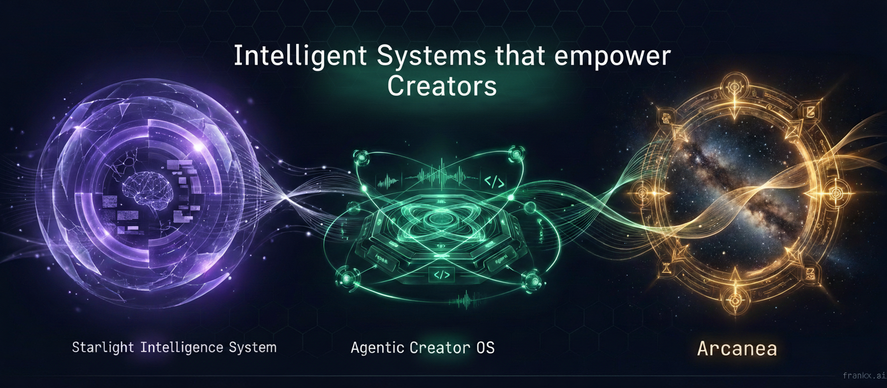

  

<h1 align="center">Frank Riemer · Founder & AI Architect</h1>

<strong>Building intelligence that compounds.</strong>

I build AI systems, creator tools and original worlds. My work connects the engineering behind useful intelligence with the craft of turning it into a product, a business or a story people care about.

I'm based in Amsterdam. Formerly an AI Architect in Oracle's EMEA AI Center of Excellence, I now lead a founder portfolio across Starlight Intelligence, GenCreator and Arcanea, and share the work through [FrankX](https://frankx.ai).

## Explore the work

| Direction | What I'm building | Start here |
| --- | --- | --- |
| **Starlight Intelligence** | Portable context, agent coordination and ways to inspect the work an AI system performs. | [Reference system](https://github.com/frankxai/Starlight-Intelligence-System) · [Starlight](https://starlightintelligence.ai) |
| **GenCreator & ACOS** | Creator workflows that connect an idea to writing, media and a finished release. | [Agentic Creator OS](https://github.com/frankxai/agentic-creator-os) · [Creator skills](https://github.com/frankxai/creator-skills) · [GenCreator](https://gencreator.ai) |
| **Arcanea** | Original worlds, stories and tools for people who want to create inside them. | [Arcanea](https://github.com/frankxai/arcanea) · [Web application source](https://github.com/frankxai/arcanea-ai-app) · [Explore the world](https://arcanea.ai) |
| **FrankX** | Practical architecture, founder field notes, education and creative experiments. | [Architecture skills](https://github.com/frankxai/skills) · [Writing and projects](https://frankx.ai) |

Music is part of the practice. I compose, experiment with AI-assisted production and explore how sound changes the experience of a story or a working day.

## Build with me

I work with founders, creative teams and technology partners on three kinds of work:

- **AI architecture and working prototypes:** turn an important workflow into a scoped system with clear ownership, evaluation and a usable handoff.
- **Workshops and practical education:** help a team build something it can inspect, understand and continue.
- **Product and creative collaborations:** develop useful tools, public demonstrations, original IP and thoughtful routes to market.

For a collaboration, share the problem, who it serves and the result we could demonstrate together: [frank@frankx.ai](mailto:frank@frankx.ai).

## How I lead

I take responsibility for the quality of the work and the clarity of its promises. I approach the portfolio as a founder and investor: build useful assets, retain the ability to improve them and reinvest with a long horizon.

The standard is simple: show the artifact, explain the decision, name what remains unresolved and give the next person something worth building on.

[Portfolio and organization map](ECOSYSTEM.md) · [Bio and speaker copy](BIO.md)

  <a href="https://frankx.ai">frankx.ai</a> ·
  <a href="https://www.linkedin.com/in/frank-x-riemer/">LinkedIn</a> ·
  <a href="https://www.youtube.com/@frankxai">YouTube</a>

